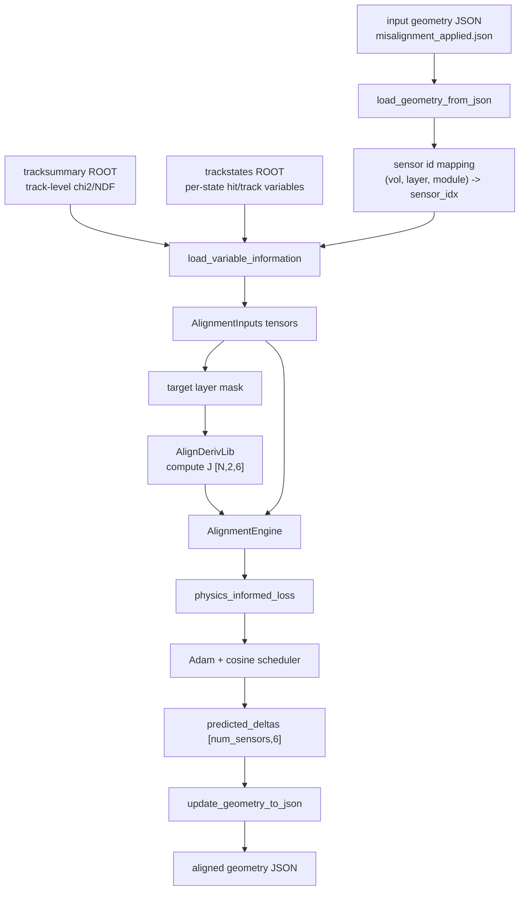

# `ml_alignment.py` 代码原理技术文档

本文档解释 `Examples/Scripts/Python/job/ml_alignment.py` 的当前实现。脚本目标是读取 ACTS 输出的错位几何和重建结果，构造逐 hit 的对齐训练样本，通过 PyTorch 优化每个传感器面的 6 自由度刚体修正，并把修正后的几何写回 JSON。

## 1. 整体框架

脚本主入口是 `run_alignment_pipeline()`，整体数据流如下：



主要模块分工如下：

| 模块 | 代码对象 | 作用 |
|---|---|---|
| 配置 | `AlignmentRunConfig` | 定义输入几何、ROOT 文件、输出路径、目标层、自由度、epoch、正则强度等运行参数。 |
| 数据容器 | `AlignmentInputs` | 保存训练所需的 PyTorch 张量，包括 residual、covariance、track 参数、hit 位置、方向、ID 等。 |
| 几何读取 | `load_geometry_from_json()` | 读取 detector transform JSON，并建立 `(volume_id, layer_id, module_id) -> sensor_idx` 映射。 |
| ROOT 数据处理 | `load_variable_information()` | 从 `tracksummary` 和 `trackstates` 中读取、合并、清洗数据，并转为张量。 |
| Jacobian 计算 | `compute_jacobians_from_alignderivlib()` | 调用 `align_deriv_pb`，为每个 hit 计算 `2x6` 几何残差雅可比。 |
| 模型 | `AlignmentEngine` | 持有可训练的 `alignment_params[num_sensors, 6]`；hit 权重网络是未接入运行入口的实验代码。 |
| 损失函数 | `physics_informed_loss()` | 计算带 hit 权重的残差卡方。 |
| 几何更新 | `update_geometry_to_json()` | 将局部平移和局部旋转增量合成到原 detector transform。 |

## 2. 数据处理流程

### 2.1 几何 JSON

`load_geometry_from_json(filepath)` 读取当前迭代使用的几何文件，要求 JSON 顶层是 list，且元素包含 `Translation`。每个元素代表一个 detector module transform，常用字段包括：

- `ID`：形如 `vol=17|lay=8|sen=...`，用于解析 volume、layer、module。
- `Translation`：传感器中心全局坐标。
- `RotationMatrix`：传感器局部坐标系到全局坐标系的旋转矩阵。
- `FullMatrix`：可选的 4x4 齐次变换矩阵。

函数返回：

```text
original_data, transforms_list, num_sensors, initial_positions, id_to_idx
```

其中 `id_to_idx[(vol, lay, sen)] = i` 是后续把 ROOT hit 映射到几何面的关键索引。

### 2.2 tracksummary ROOT

`tracksummary` tree 读取字段：

```text
event_nr, track_nr, chi2Sum, NDF
```

代码将其改名为：

```text
chi2 = chi2Sum
ndf = NDF
chi2_ndf = chi2 / ndf
```

`chi2_ndf` 后续作为 hit quality network 的输入特征之一，表示该 hit 所属轨迹的整体拟合质量。

### 2.3 trackstates ROOT

当前实现读取 per-state 字段：

```text
volume_id, layer_id, module_id
l_x_hit, l_y_hit
eLOC0_smt, eLOC1_smt
err_eLOC0_smt, err_eLOC1_smt
g_x_smt, g_y_smt, g_z_smt
px_smt, py_smt, pz_smt
ePHI_smt, eTHETA_smt, eQOP_smt
```

这些字段按 track state 展开。`l_x_hit` 和 `l_y_hit` 是局部测量坐标；没有测量的 hole/material state 中 `l_x_hit` 为 `NaN`。

`err_x_hit` 和 `err_y_hit` 是 per-measurement 数组，不一定与 per-state 数组等长。代码采用以下方法对齐：

1. 读取 jagged `l_x_hit`，用 `~np.isnan(l_x_hit)` 标记真实测量 state。
2. 读取 per-measurement 的 `err_x_hit` / `err_y_hit`。
3. 为每条轨迹创建 state 等长的 `ex` / `ey`，非测量 state 填 `NaN`。
4. 若 per-measurement error 数量等于测量 state 数量，则把 error 填回测量位置。
5. flatten 后写入 `states_df["err_x_hit"]` 和 `states_df["err_y_hit"]`。

这一步解决了 ACTS ROOT 文件中 per-state 分支和 per-measurement 分支长度不同的问题。

### 2.4 event/track 广播与合并

`event_nr` 和 `track_nr` 是 per-event/per-track 粒度。代码通过：

```python
counts = ak.to_numpy(ak.num(volume_id_jagged, axis=1))
states_df["event_nr"] = np.repeat(ev_flat, counts)
states_df["track_nr"] = np.repeat(tr_flat, counts)
```

将它们广播到 per-state 行。随后用：

```python
pd.merge(states_df, sum_df, on=["event_nr", "track_nr"], how="inner")
```

把轨迹级 `chi2_ndf` 合并到每个 hit state。

### 2.5 hit 清洗与 sensor 映射

清洗步骤按顺序执行：

1. 保留测量 state：`l_x_hit.notna()`。
2. 用 `(volume_id, layer_id, module_id)` 映射到 `sensor_idx`。
3. 构造当前实现使用的残差：

   ```text
   res_eLOC0 = l_x_hit - eLOC0_smt
   res_eLOC1 = l_y_hit - eLOC1_smt
   ```

4. 若 `err_x_hit` / `err_y_hit` 缺失，用 `err_eLOC0_smt` / `err_eLOC1_smt` 做 fallback。
5. 构造方差：

   ```text
   var_eLOC0 = err_x_hit^2
   var_eLOC1 = err_y_hit^2
   ```

6. 对 1D strip hit，若 `l_y_hit` 为 `NaN`：

   ```text
   res_eLOC1 = 0
   var_eLOC1 = 1
   weight_eLOC1 = 0
   ```

   这样 LOC1 不参与 loss。

7. 对 ShortStrip 体积 `23, 24, 25` 的 2D hit，给 LOC1 方差设置下限：

   ```text
   var_eLOC1 >= STRIP_Y_FLOOR = 1.44 mm^2
   ```

   这对应约 `1.2 mm` 的 Y 向本征分辨率，避免 Y 向误差过小导致优化器过度修正。

8. 删除 `sensor_idx`、残差、方差、权重和 smoothed global position 中仍有 `NaN` 的行。
9. 删除 `module_id <= 0` 的行。

### 2.6 张量构造

清洗后的 DataFrame 转为 `AlignmentInputs`：

| 张量 | 形状 | 来源字段 | 含义 |
|---|---:|---|---|
| `hit_sensor_ids` | `[N]` | `sensor_idx` | 每个 hit 对应的 geometry sensor 索引。 |
| `initial_residuals` | `[N,2]` | `res_eLOC0`, `res_eLOC1` | 当前几何下的局部残差。 |
| `covariances` | `[N,2]` | `var_eLOC0`, `var_eLOC1` | LOC0/LOC1 对角方差。 |
| `track_params` | `[N,5]` | `eLOC0_smt`, `eLOC1_smt`, `eTHETA_smt`, `ePHI_smt`, `eQOP_smt` | hit quality network 的轨迹状态特征。 |
| `track_chi2_ndf` | `[N,1]` | `chi2_ndf` | 轨迹拟合质量。 |
| `hit_global_positions` | `[N,3]` | `g_x_smt`, `g_y_smt`, `g_z_smt` | Jacobian 计算用的全局位置。 |
| `hit_directions` | `[N,3]` | `px_smt`, `py_smt`, `pz_smt` | Jacobian 计算用的方向，代码会归一化。 |
| `hit_qoverp` | `[N,1]` | `eQOP_smt` | Jacobian 计算用的 q/p。 |
| `hit_volume_ids` / `hit_layer_ids` / `hit_module_ids` | `[N]` | ROOT ID | 分层训练、诊断和权重归一化。 |
| `hit_event_ids` / `hit_track_ids` | `[N]` | `event_nr`, `track_nr` | 保留 hit 归属信息。 |
| `act_weights` | `[N,2]` | `weight_eLOC0`, `weight_eLOC1` | 当前构造但训练 loss 中未直接使用。 |

## 3. 数学模型与公式推导

### 3.1 对齐参数定义

每个传感器面有 6 个可训练对齐参数：

```text
δα = [δt_x, δt_y, δt_z, δr_x, δr_y, δr_z]^T
```

前三项是局部坐标系下的平移，后三项是局部坐标系下的欧拉角旋转。代码中所有传感器参数组成矩阵：

```text
alignment_params ∈ R^(num_sensors x 6)
```

`AlignmentEngine.forward()` 根据 `hit_sensor_ids` 为每个 hit 取出对应 sensor 的 `δα_i`。

### 3.2 当前残差定义

对第 `i` 个 hit，局部测量为：

```text
m_i = [l_x_hit, l_y_hit]^T
```

当前实现使用 smoothed track state 的局部参数：

```text
x_i = [eLOC0_smt, eLOC1_smt]^T
```

因此初始残差为：

```math
r_i^{(0)} = m_i - x_i
```

对应代码：

```python
merged_df["res_eLOC0"] = merged_df["l_x_hit"] - merged_df["eLOC0_smt"]
merged_df["res_eLOC1"] = merged_df["l_y_hit"] - merged_df["eLOC1_smt"]
```

所有 hit 组成：

```math
R^{(0)} =
\begin{bmatrix}
r_1^{(0)T} \\
r_2^{(0)T} \\
\cdots \\
r_N^{(0)T}
\end{bmatrix}
\in \mathbb{R}^{N \times 2}
```

### 3.3 一阶线性化

探测器面发生小的刚体扰动 `δα` 后，残差变化可以用一阶 Taylor 展开表示：

```math
r_i(\delta\alpha_i)
\approx
r_i^{(0)} -
J_i \delta\alpha_i
```

其中：

```math
J_i =
\frac{\partial r_i}{\partial \alpha_i}
\in \mathbb{R}^{2 \times 6}
```

代码中 `compute_jacobians_from_alignderivlib()` 为每个 hit 调用：

```python
J = surface.alignmentToResidualDerivative(free_track, pos, 0.0)
```

返回 `H_geom_batch[i] = J_i`。在 `AlignmentEngine.forward()` 中：

```python
current_params = self.alignment_params[hit_sensor_ids]       # [N,6]
shift_effect = torch.bmm(H_geom_batch, current_params.unsqueeze(-1)).squeeze(-1)
```

数学上就是：

```math
\Delta r_i = J_i \delta\alpha_i
```

新的残差为：

```math
r_i^{new} = r_i^{(0)} - \Delta r_i
= r_i^{(0)} - J_i\delta\alpha_i
```

对应 `physics_informed_loss()`：

```python
new_residuals = initial_residuals - shift_effect
```

### 3.4 Jacobian 的几何含义

`J_i` 把一个 6D sensor 刚体扰动映射到 2D 局部残差变化：

```math
\begin{bmatrix}
\Delta r_{u} \\
\Delta r_{v}
\end{bmatrix}
=
\begin{bmatrix}
\frac{\partial r_u}{\partial t_x} &
\frac{\partial r_u}{\partial t_y} &
\frac{\partial r_u}{\partial t_z} &
\frac{\partial r_u}{\partial r_x} &
\frac{\partial r_u}{\partial r_y} &
\frac{\partial r_u}{\partial r_z} \\
\frac{\partial r_v}{\partial t_x} &
\frac{\partial r_v}{\partial t_y} &
\frac{\partial r_v}{\partial t_z} &
\frac{\partial r_v}{\partial r_x} &
\frac{\partial r_v}{\partial r_y} &
\frac{\partial r_v}{\partial r_z}
\end{bmatrix}
\begin{bmatrix}
\delta t_x \\
\delta t_y \\
\delta t_z \\
\delta r_x \\
\delta r_y \\
\delta r_z
\end{bmatrix}
```

其中 `u` 对应 ACTS `local0` / `eLOC0`，`v` 对应 ACTS `local1` / `eLOC1`。

代码为每个 sensor 构造 `ad.PlaneSurface(center, rotation)`。若训练中已经有当前 `alignment_params`，则周期性用当前修正更新 Jacobian 的几何展开点：

```python
center = center + rotation @ delta_t
rotation = rotation @ euler_to_rotation_matrix(alpha, beta, gamma)
```

这对应非线性问题的迭代线性化：

```math
J^{(k)} = J(\alpha^{(k)})
```

默认每 `DEFAULT_JACOBIAN_UPDATE_INTERVAL = 20` 个 epoch 重新计算一次。

### 3.5 方差与卡方

当前实现使用对角方差：

```math
\sigma_i^2 =
\begin{bmatrix}
\sigma_{u,i}^2 \\
\sigma_{v,i}^2
\end{bmatrix}
=
\begin{bmatrix}
err\_x\_hit_i^2 \\
err\_y\_hit_i^2
\end{bmatrix}
```

代码中：

```python
raw_chi2 = (new_residuals ** 2) / torch.clamp(covariances, min=EPS_COVARIANCE)
```

即逐 hit、逐坐标的：

```math
\chi^2_{i,d}
=
\frac{(r_{i,d}^{(0)} - (J_i\delta\alpha_i)_d)^2}
{\max(\sigma_{i,d}^2, \epsilon)}
,\quad d \in \{u,v\}
```

`EPS_COVARIANCE = 1e-8` 防止除零。

### 3.6 hit quality network 权重

`AlignmentEngine` 含一个可选的小型 MLP，但当前默认值是
`use_hit_weights=False`，运行入口也没有开启它。因此正式运行中的 hit 权重恒为 1，
下面仅记录尚未接入的实验实现：

```text
Linear(9 -> 32) -> GELU -> Linear(32 -> 16) -> GELU -> Linear(16 -> 1)
```

输入特征由三部分拼接：

```text
[track_params(5), sensor_center_position(3), track_chi2_ndf(1)]
```

因此输入维度为：

```text
5 + 3 + 1 = 9
```

网络输出 raw logit 后经过 sigmoid 和下限缩放：

```math
w_i^{raw}
=
w_{floor} + (1 - w_{floor}) \cdot sigmoid(z_i)
```

其中：

```text
HIT_WEIGHT_FLOOR = 0.3
```

所以 hit 权重范围为：

```math
w_i^{raw} \in [0.3, 1.0]
```

为了避免某一层整体权重被网络任意缩放，`normalize_hit_weights()` 对每个 `(volume_id, layer_id)` 单独归一化：

```math
w_i =
\frac{w_i^{raw}}
{\frac{1}{|\mathcal{L}(i)|}\sum_{j \in \mathcal{L}(i)} w_j^{raw} + \epsilon}
```

其中 `\mathcal{L}(i)` 表示第 `i` 个 hit 所属的 volume/layer 集合。

最终 loss 中的卡方项为：

```math
L_{\chi^2}
=
\frac{1}{2N}
\sum_{i=1}^{N}
\sum_{d \in \{u,v\}}
w_i
\frac{(r_{i,d}^{(0)} - (J_i\delta\alpha_i)_d)^2}
{\max(\sigma_{i,d}^2, \epsilon)}
```

代码实际使用 `torch.mean(w_normalized * raw_chi2)`，因此分母是参与统计的元素数量。

### 3.7 L2 正则与总损失

训练总损失为：

```math
L
=
L_{\chi^2}
+
\lambda
\sum_s
\|\delta\alpha_s\|_2^2
```

对应代码：

```python
l2_reg = config.lambda_l2 * torch.sum(engine.alignment_params ** 2)
loss = chi2_loss + l2_reg
```

默认：

```text
DEFAULT_LAMBDA_L2 = 1e-5
```

L2 正则防止 sensor 修正幅度在弱约束自由度上发散。

## 4. 训练流程

### 4.1 目标层 mask

`run_alignment_pipeline()` 根据 `target_layers` 构造训练 hit mask：

```python
training_hit_mask |= (inputs.hit_volume_ids == vol) & (inputs.hit_layer_ids == lay)
```

默认目标层：

```text
DEFAULT_TARGET_LAYERS = ((17, 8), (24, 4))
```

只有这些层上的 hit 参与训练 loss。

如果 `fix_reference=True`，还会构造 sensor 级 `target_mask`：

```python
target_mask = build_target_mask(NUM_SENSORS, id_to_idx_map, TARGET_LAYERS)
```

反向传播后：

```python
engine.alignment_params.grad[~target_mask] = 0.0
engine.alignment_params[~target_mask] = 0.0
```

这表示非目标层作为固定参考，不被优化。

### 4.2 自由度 mask

`active_dof` 控制哪些 6D 对齐参数可训练。当前命令行默认值按径迹模式区分：

```text
surface: (0,1,3,4,5) = tx,ty,rx,ry,rz
free:    (0,1,3,4)   = tx,ty,rx,ry
```

free 的历史默认值不含 `rz`，不一定匹配当前错位注入配方；未显式指定时程序会打印风险告警。
正式运行应根据待校准的物理自由度显式传入 `--active-dof`，不得从 nominal 真值自动选择。

代码用 `dof_mask` 将非激活自由度梯度清零，并在每个 step 后强制参数为 0：

```python
engine.alignment_params.grad[:, ~dof_mask] = 0.0
engine.alignment_params[:, ~dof_mask] = 0.0
```

### 4.3 Adam 优化

优化器和学习率调度器：

```python
optimizer = optim.Adam(engine.parameters(), lr=DEFAULT_ADAM_LR)
scheduler = optim.lr_scheduler.CosineAnnealingLR(
    optimizer, T_max=config.epochs, eta_min=DEFAULT_ADAM_ETA_MIN
)
```

默认参数：

```text
DEFAULT_EPOCHS = 500
DEFAULT_ADAM_LR = 1e-2
DEFAULT_ADAM_ETA_MIN = 1e-5
```

每个 epoch 的核心步骤：

1. 按周期重新计算 Jacobian。
2. 前向计算 `shift_effect = J δα` 和 hit 权重。
3. 计算 `chi2_loss + L2`。
4. `loss.backward()`。
5. 清除非激活 DOF 和非目标 sensor 的梯度。
6. 做梯度裁剪：

   ```python
   torch.nn.utils.clip_grad_norm_(engine.parameters(), max_norm=10.0)
   ```

7. Adam step 与 scheduler step。
8. 对参数做硬截断：

   ```text
   translation: [-1.5, 1.5] mm
   rotation:    [-0.05, 0.05] rad
   ```

这对应：

```python
engine.alignment_params[:, :3].clamp_(-ADAM_CLAMP_T, ADAM_CLAMP_T)
engine.alignment_params[:, 3:].clamp_(-ADAM_CLAMP_R, ADAM_CLAMP_R)
```

## 5. 几何更新公式

优化结束后得到：

```text
predicted_deltas[i] = [δt_x, δt_y, δt_z, δr_x, δr_y, δr_z]
```

`update_geometry_to_json()` 对每个 sensor 更新 `Translation` 和 `RotationMatrix`。

设旧几何为：

```math
t_{old} \in \mathbb{R}^3,\quad R_{old} \in SO(3)
```

局部平移为：

```math
\delta t_{local} =
\begin{bmatrix}
\delta t_x \\
\delta t_y \\
\delta t_z
\end{bmatrix}
```

因为 `δt` 在 sensor local frame 中定义，所以转换到全局坐标后加到中心：

```math
t_{new} = t_{old} + R_{old}\delta t_{local}
```

旋转增量由欧拉角生成：

```math
R_{\delta}
=
R_z(\gamma) R_y(\beta) R_x(\alpha)
```

对应 `euler_to_rotation_matrix(alpha, beta, gamma)`：

```math
R_x(\alpha)=
\begin{bmatrix}
1 & 0 & 0 \\
0 & \cos\alpha & -\sin\alpha \\
0 & \sin\alpha & \cos\alpha
\end{bmatrix}
```

```math
R_y(\beta)=
\begin{bmatrix}
\cos\beta & 0 & \sin\beta \\
0 & 1 & 0 \\
-\sin\beta & 0 & \cos\beta
\end{bmatrix}
```

```math
R_z(\gamma)=
\begin{bmatrix}
\cos\gamma & -\sin\gamma & 0 \\
\sin\gamma & \cos\gamma & 0 \\
0 & 0 & 1
\end{bmatrix}
```

最终旋转更新为：

```math
R_{new} = R_{old}R_{\delta}
```

代码对应：

```python
new_t = old_t + old_R @ delta_t_local
new_R = old_R @ R_delta
```

然后重建 4x4 齐次矩阵：

```math
T_{new} =
\begin{bmatrix}
R_{new} & t_{new} \\
0 & 1
\end{bmatrix}
```

若原 JSON 中存在 `FullMatrix`，代码会根据旧矩阵的 flatten 排列方式，选择 Fortran order 或 C order 写回，尽量保持原格式兼容。

## 6. 诊断与输出

训练前后脚本会输出若干诊断：

### 6.1 目标层初始残差

`print_target_residual_stats()` 输出每个目标层的：

```text
N, mean LOC0, RMS LOC0, mean LOC1, RMS LOC1
```

用于检查训练信号是否存在。

### 6.2 epoch 日志

每 10 个 epoch 或第 1 个 epoch 输出：

```text
LR
Chi2
L2
Total
hit weight mean/std/min
per-layer chi2
per-layer raw/normalized weight mean
```

这可以判断 loss 是否收敛、权重网络是否塌缩、某一层是否主导训练。

### 6.3 训练后残差诊断

`print_per_layer_residual_diagnostics()` 比较训练数据上的 residual mean 和 RMS：

```text
before: r^(0)
after:  r^(0) - J δα
```

这是线性化训练空间中的改善，不等价于重新跑 ACTS reconstruction 后的最终闭环验证。

### 6.4 truth geometry 对比

`validate_against_truth()` 若能读取 `nominal_file`，会比较 ML 修正和真实错位修正：

```math
\delta t_{true} = R_{mis}^{T}(c_{nom} - c_{mis})
```

```math
R_{\delta,true} = R_{mis}^{T}R_{nom}
```

当前输出重点统计 `tx`, `ty`, `rz`：

```text
corr
recovery
|true| rms
|pred| rms
```

其中 recovery 是预测向量在真值向量方向上的投影比例：

```math
recovery =
\frac{p \cdot t}{t \cdot t}
```

### 6.5 文件输出

主要输出：

- `output_geom`：更新后的 geometry JSON。
- `loss_curve_*.png`：若 `make_plot=True`，保存训练 loss 曲线。
- 函数返回值：

```python
{
    "output_geom": ALIGNED_JSON_FILE,
    "target_metrics": target_metrics,
    "predicted_deltas": predicted_deltas,
}
```

`target_metrics` 包含每个目标层的 hit 数量、训练前后 LOC0/LOC1 mean 和 RMS。

## 7. 命令行参数

脚本可直接运行：

```bash
python ml_alignment_autograd.py --track-mode free \
  --input-geom alignment_output/Vol16_Lay6__Vol23_Lay4/misalignment_applied_v16l6_v23l4.json \
  --states reconstruction_output/misaligned/Vol16_Lay6__Vol23_Lay4/trackstates_kf_v16l6_v23l4.root \
  --summary reconstruction_output/misaligned/Vol16_Lay6__Vol23_Lay4/tracksummary_kf_v16l6_v23l4.root \
  --output-geom alignment_output/Vol16_Lay6__Vol23_Lay4/aligned_transforms_joint.json \
  --target-layers 16:6,23:4 \
  --active-dof tx,ty,rz \
  --joint-iters 1000
```

常用参数：

| 参数 | 含义 |
|---|---|
| `--input-geom` | 当前迭代几何 `G_k`，优化增量会合成到它上面。 |
| `--states` | 使用 `G_k` reconstruction 得到的 `trackstates` ROOT。 |
| `--summary` | 使用 `G_k` reconstruction 得到的 `tracksummary` ROOT。 |
| `--output-geom` | 输出几何 `G_{k+1}`。 |
| `--nominal` | nominal/truth geometry，用于诊断预测修正是否接近真值。 |
| `--target-layers` | 训练目标层，格式为 `volume:layer,volume:layer`。 |
| `--active-dof` | 激活自由度，可用索引或名称，如 `0,1` 或 `tx,ty,rz`。 |
| `--epochs` | Adam 训练轮数。 |
| `--jacobian-update-interval` | 每隔多少 epoch 用当前几何重新计算 Jacobian。 |
| `--lambda-l2` | L2 正则系数。 |
| `--no-plot` | 不输出 loss 曲线 PNG。 |

## 8. 关键实现约束

- 当前实现是逐 sensor 的对齐参数优化，但 loss 只使用目标层 hit。
- `alignment_params` 是直接可训练参数，不是由神经网络从 hit 特征预测出来的；当前运行入口未启用 hit 权重网络。
- Jacobian 由外部 `AlignDerivLib` Python binding `align_deriv_pb` 计算，PyTorch 不对 Jacobian 本身求梯度。
- 每个 hit 的 correction effect 使用线性近似 `J δα`；非线性通过周期性重算 Jacobian 缓解。
- 几何修正在 local frame 中表达，写回 JSON 时平移使用 `R_old @ δt_local` 转到 global frame。
- 1D strip hit 的 LOC1 被显式置零权重，不参与训练。
- ShortStrip volume `23, 24, 25` 的 LOC1 方差下限是当前代码中的经验物理约束。
